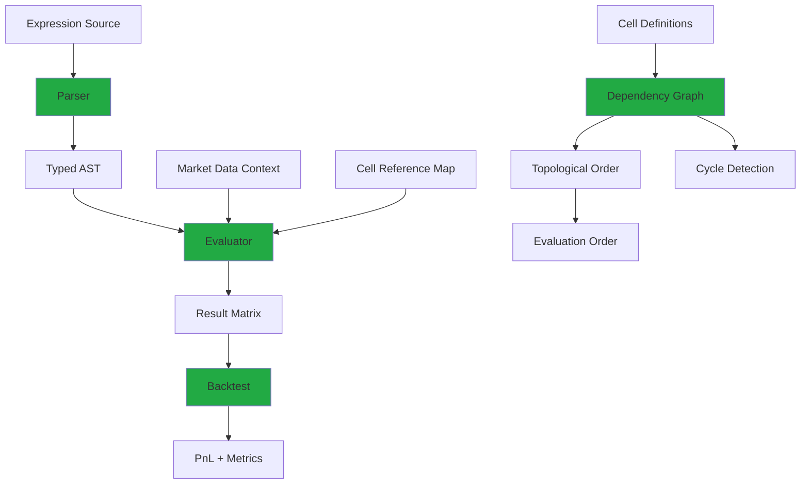
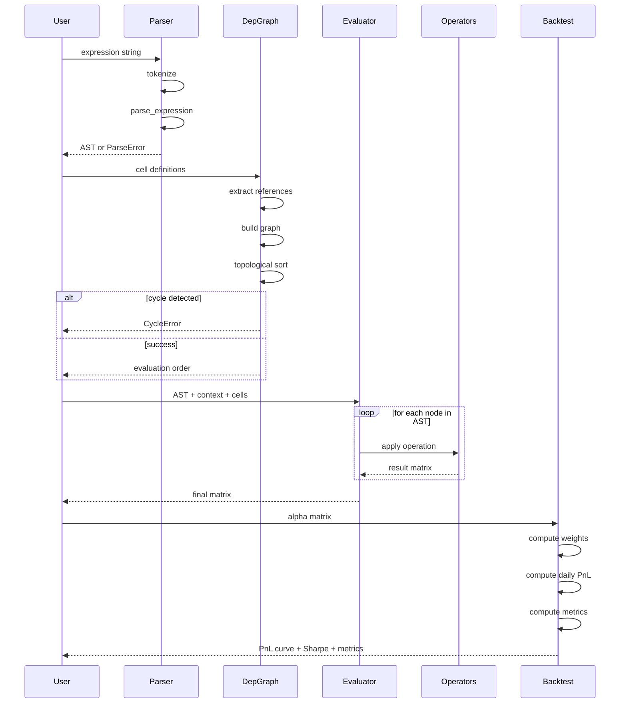

# Design Document: Formula Engine

## Overview

The Row-Quant formula engine is a pure TypeScript computation system that parses WorldQuant BRAIN-style expressions, evaluates them over historical financial data matrices, and produces backtested alpha signals with performance metrics. The engine operates entirely in-browser within a Web Worker, ensuring non-blocking recalculation. Every value is a matrix (days × stocks) represented as `Float64Array` in row-major order, with `NaN` representing missing data. The engine consists of five core subsystems: a hand-written recursive-descent parser that produces a strongly-typed AST; a comprehensive operator library implementing cross-sectional, time-series, and element-wise operations; an evaluator that recursively computes matrices from AST nodes; a dependency graph manager that tracks cell references, performs topological sorting, and detects cycles; and a delay-1 backtest module that converts alpha matrices into daily portfolio weights and computes Sharpe ratio, annual return, turnover, and maximum drawdown.

## Architecture



## Main Algorithm/Workflow



## Components and Interfaces

### Component 1: Parser

**Purpose**: Transform source text into a strongly-typed AST using recursive-descent parsing

**Interface**:
```typescript
interface Parser {
  parse(source: string): Result<ASTNode, ParseError>
  print(ast: ASTNode): string  // For round-trip property testing
}

type Result<T, E> = { ok: true; value: T } | { ok: false; error: E }

interface ParseError {
  message: string
  position: number
  line: number
  column: number
}
```

**Responsibilities**:
- Tokenize input into lexical units
- Parse expressions using recursive-descent with operator precedence
- Construct typed AST nodes with proper nesting
- Report precise error locations
- Support round-trip serialization (parse(print(ast)) === ast)

### Component 2: AST Definitions

**Purpose**: Strongly-typed abstract syntax tree representing all valid expressions

**Interface**:
```typescript
type ASTNode =
  | { type: 'Literal'; value: number }
  | { type: 'DataField'; name: DataFieldName }
  | { type: 'CellRef'; cell: string }  // e.g., "A1", "B12"
  | { type: 'UnaryOp'; op: UnaryOperator; operand: ASTNode }
  | { type: 'BinaryOp'; op: BinaryOperator; left: ASTNode; right: ASTNode }
  | { type: 'FunctionCall'; name: FunctionName; args: ASTNode[] }

type DataFieldName = 'open' | 'high' | 'low' | 'close' | 'volume' | 'vwap' | 'returns' | 'sector'

type UnaryOperator = 'neg' | 'abs' | 'sign' | 'log' | 'sqrt'

type BinaryOperator = 'add' | 'sub' | 'mul' | 'div' | 'lt' | 'gt' | 'lte' | 'gte' | 'eq' | 'max' | 'min'

type FunctionName =
  // Cross-sectional
  | 'rank' | 'zscore' | 'scale' | 'group_neutralize'
  // Time-series
  | 'ts_delay' | 'ts_delta' | 'ts_mean' | 'ts_sum' | 'ts_std_dev' | 'ts_rank' | 'ts_decay_linear' | 'ts_corr'
  // Conditional
  | 'if_else'
```

**Responsibilities**:
- Represent all valid expression constructs
- Enforce type safety at compile time
- Support pattern matching for evaluation
- Enable AST transformations and serialization

### Component 3: Operators

**Purpose**: Implement all matrix operations from semantics.md with correct NaN handling

**Interface**:
```typescript
interface Matrix {
  data: Float64Array    // row-major: data[t * nStocks + i]
  nDays: number
  nStocks: number
}

// Cross-sectional operators (per day, across stocks)
function rank(x: Matrix): Matrix
function zscore(x: Matrix): Matrix
function scale(x: Matrix): Matrix
function group_neutralize(x: Matrix, groups: Matrix): Matrix

// Time-series operators (per stock, across days)
function ts_delay(x: Matrix, d: number): Matrix
function ts_delta(x: Matrix, d: number): Matrix
function ts_mean(x: Matrix, d: number): Matrix
function ts_sum(x: Matrix, d: number): Matrix
function ts_std_dev(x: Matrix, d: number): Matrix
function ts_rank(x: Matrix, d: number): Matrix
function ts_decay_linear(x: Matrix, d: number): Matrix
function ts_corr(x: Matrix, y: Matrix, d: number): Matrix

// Element-wise operators
function add(x: Matrix, y: Matrix): Matrix
function sub(x: Matrix, y: Matrix): Matrix
function mul(x: Matrix, y: Matrix): Matrix
function div(x: Matrix, y: Matrix): Matrix
function neg(x: Matrix): Matrix
function abs_op(x: Matrix): Matrix
function sign_op(x: Matrix): Matrix
function log_op(x: Matrix): Matrix
function sqrt_op(x: Matrix): Matrix
function max_op(x: Matrix, y: Matrix): Matrix
function min_op(x: Matrix, y: Matrix): Matrix
function lt(x: Matrix, y: Matrix): Matrix
function gt(x: Matrix, y: Matrix): Matrix
function lte(x: Matrix, y: Matrix): Matrix
function gte(x: Matrix, y: Matrix): Matrix
function eq(x: Matrix, y: Matrix): Matrix
function if_else(cond: Matrix, a: Matrix, b: Matrix): Matrix  // NaN from cond or selected branch only
function ts_corr(x: Matrix, y: Matrix, d: number): Matrix  // Clamped to [-1, 1]

// Scalar broadcasting
function scalar_to_matrix(value: number, nDays: number, nStocks: number): Matrix
```

**Responsibilities**:
- Implement all operators with correct NaN propagation
- if_else propagates NaN only from cond and the selected branch (unselected branch NaN is ignored)
- ts_corr clamps output to [-1, 1] to handle floating-point rounding
- Handle edge cases (all-equal rows, all-NaN windows, division by zero)
- Maintain mathematical invariants (rank in [0,1], group means = 0)
- Optimize for performance with typed arrays
- Support scalar broadcasting

### Component 4: Evaluator

**Purpose**: Recursively evaluate AST nodes in context to produce result matrices

**Interface**:
```typescript
interface EvaluationContext {
  data: {
    open: Matrix
    high: Matrix
    low: Matrix
    close: Matrix
    volume: Matrix
    vwap: Matrix
    returns: Matrix
    sector: Matrix
  }
  cells: Map<string, Matrix>  // Resolved cell values (A1 -> matrix)
}

interface Evaluator {
  evaluate(ast: ASTNode, context: EvaluationContext): Result<Matrix, EvaluationError>
}

interface EvaluationError {
  message: string
  node: ASTNode
}
```

**Responsibilities**:
- Traverse AST recursively
- Dispatch to appropriate operator functions
- Resolve cell references from context
- Handle scalar literals with broadcasting
- Propagate errors with context
- Ensure pure, deterministic evaluation

### Component 5: Dependency Graph

**Purpose**: Track cell dependencies, compute evaluation order, detect cycles

**Interface**:
```typescript
interface CellDefinition {
  cell: string        // e.g., "A1"
  ast: ASTNode
}

interface DependencyGraph {
  addCell(def: CellDefinition): void
  getEvaluationOrder(): Result<string[], CycleError>
  getDependencies(cell: string): string[]
  hasCycle(): boolean
}

interface CycleError {
  message: string
  cycle: string[]  // Cells forming the cycle
}
```

**Responsibilities**:
- Extract cell references from AST nodes
- Build directed graph of dependencies
- Perform topological sort for evaluation order
- Detect and report dependency cycles
- Support incremental updates when cells change

### Component 6: Backtest

**Purpose**: Convert alpha matrix into weights, compute daily PnL, calculate performance metrics

**Interface**:
```typescript
interface BacktestResult {
  pnl: number[]           // Daily PnL
  cumulativePnl: number[] // Cumulative PnL curve
  sharpe: number          // Annualized Sharpe ratio
  annualReturn: number    // Annualized return
  turnover: number        // Average daily turnover
  maxDrawdown: number     // Maximum drawdown
}

interface Backtester {
  backtest(alpha: Matrix, returns: Matrix): BacktestResult
}
```

**Responsibilities**:
- Convert alpha[t] to weights[t] with delay 1
- Demean weights (market neutral)
- Scale weights so sum|w[t]| = 1
- Compute daily PnL[t+1] = sum(w[t] * returns[t+1])
- Calculate Sharpe = mean/std * sqrt(252)
- Calculate annual return = mean * 252
- Calculate turnover = mean(sum|w[t] - w[t-1]|)
- Calculate max drawdown on cumulative PnL

## Data Models

### Matrix

```typescript
interface Matrix {
  data: Float64Array    // row-major: data[t * nStocks + i]
  nDays: number         // Number of trading days
  nStocks: number       // Number of stocks
}

// Helper functions
function getElement(m: Matrix, day: number, stock: number): number {
  return m.data[day * m.nStocks + stock]
}

function setElement(m: Matrix, day: number, stock: number, value: number): void {
  m.data[day * m.nStocks + stock] = value
}

function createMatrix(nDays: number, nStocks: number): Matrix {
  const data = new Float64Array(nDays * nStocks);
  data.fill(NaN);  // Initialize to NaN (missing values must NEVER be 0)
  return {
    data,
    nDays,
    nStocks
  }
}
```

**Validation Rules**:
- `nDays` and `nStocks` must be positive integers
- `data.length` must equal `nDays * nStocks`
- Missing values represented as `NaN`, never `0`
- Indices are 0-based: day ∈ [0, nDays), stock ∈ [0, nStocks)

**Performance Note**:
- `getElement()` and `setElement()` include bounds checking for safety in tests
- In operators, evaluator, and backtest hot loops, index `m.data[t * m.nStocks + i]` directly for performance, not through bounds-checked helpers

### AST Node Examples

```typescript
// Literal: 42
const literalNode: ASTNode = { type: 'Literal', value: 42 }

// Data field: close
const dataFieldNode: ASTNode = { type: 'DataField', name: 'close' }

// Cell reference: A1
const cellRefNode: ASTNode = { type: 'CellRef', cell: 'A1' }

// Unary: -close
const unaryNode: ASTNode = {
  type: 'UnaryOp',
  op: 'neg',
  operand: { type: 'DataField', name: 'close' }
}

// Binary: close + open
const binaryNode: ASTNode = {
  type: 'BinaryOp',
  op: 'add',
  left: { type: 'DataField', name: 'close' },
  right: { type: 'DataField', name: 'open' }
}

// Function: rank(ts_delta(close, 5))
const functionNode: ASTNode = {
  type: 'FunctionCall',
  name: 'rank',
  args: [{
    type: 'FunctionCall',
    name: 'ts_delta',
    args: [
      { type: 'DataField', name: 'close' },
      { type: 'Literal', value: 5 }
    ]
  }]
}
```

## Algorithmic Pseudocode

### Parser: Recursive-Descent with Operator Precedence

```typescript
function parse(source: string): Result<ASTNode, ParseError> {
  const tokens = tokenize(source)
  let position = 0
  
  function parseExpression(): ASTNode {
    return parseComparison()
  }
  
  function parseComparison(): ASTNode {
    let left = parseAddSub()
    
    while (match(['<', '>', '<=', '>=', '=='])) {
      const op = previous()
      const right = parseAddSub()
      left = { type: 'BinaryOp', op: toBinaryOp(op), left, right }
    }
    
    return left
  }
  
  function parseAddSub(): ASTNode {
    let left = parseMulDiv()
    
    while (match(['+', '-'])) {
      const op = previous()
      const right = parseMulDiv()
      left = { type: 'BinaryOp', op: toBinaryOp(op), left, right }
    }
    
    return left
  }
  
  function parseMulDiv(): ASTNode {
    let left = parseUnary()
    
    while (match(['*', '/'])) {
      const op = previous()
      const right = parseUnary()
      left = { type: 'BinaryOp', op: toBinaryOp(op), left, right }
    }
    
    return left
  }
  
  function parseUnary(): ASTNode {
    if (match(['-'])) {
      const operand = parseUnary()
      return { type: 'UnaryOp', op: 'neg', operand }
    }
    
    return parsePrimary()
  }
  
  function parsePrimary(): ASTNode {
    // Number literal
    if (matchNumber()) {
      return { type: 'Literal', value: parseFloat(previous()) }
    }
    
    // Parenthesized expression
    if (match(['('])) {
      const expr = parseExpression()
      consume(')', 'Expected closing parenthesis')
      return expr
    }
    
    // Function call or data field or cell reference
    if (matchIdentifier()) {
      const name = previous()
      
      // Function call
      if (match(['('])) {
        const args: ASTNode[] = []
        if (!check(')')) {
          do {
            args.push(parseExpression())
          } while (match([',']))
        }
        consume(')', 'Expected closing parenthesis')
        return { type: 'FunctionCall', name: name as FunctionName, args }
      }
      
      // Cell reference (A1, B12, etc.)
      if (isCellReference(name)) {
        return { type: 'CellRef', cell: name }
      }
      
      // Data field
      return { type: 'DataField', name: name as DataFieldName }
    }
    
    throw parseError('Expected expression')
  }
  
  try {
    const ast = parseExpression()
    if (!isAtEnd()) {
      throw parseError('Unexpected token after expression')
    }
    return { ok: true, value: ast }
  } catch (error) {
    return { ok: false, error: error as ParseError }
  }
}
```

**Preconditions:**
- `source` is a non-null string
- Valid tokens follow the lexical grammar

**Postconditions:**
- Returns `Ok(ast)` if source is syntactically valid
- Returns `Err(error)` with precise location if invalid
- AST correctly represents operator precedence
- No tokens are skipped or duplicated

**Loop Invariants:**
- `position` points to the next unprocessed token
- All consumed tokens have been incorporated into the AST

### Cross-Sectional Rank

```typescript
function rank(x: Matrix): Matrix {
  const result = createMatrix(x.nDays, x.nStocks)
  
  // Process each day independently
  for (let t = 0; t < x.nDays; t++) {
    const row: Array<{value: number, index: number}> = []
    
    // Collect non-NaN values with their indices
    for (let i = 0; i < x.nStocks; i++) {
      const value = getElement(x, t, i)
      if (!isNaN(value)) {
        row.push({ value, index: i })
      }
    }
    
    // Handle edge cases
    if (row.length === 0) {
      // All NaN: output all NaN
      for (let i = 0; i < x.nStocks; i++) {
        setElement(result, t, i, NaN)
      }
      continue
    }
    
    if (row.length === 1) {
      // Single valid value: gets 0.5
      setElement(result, t, row[0].index, 0.5)
      continue
    }
    
    // Sort by value
    row.sort((a, b) => a.value - b.value)
    
    // Assign ranks with tie handling (average rank for ties)
    let i = 0
    while (i < row.length) {
      let j = i
      // Find all tied values
      while (j < row.length && row[j].value === row[i].value) {
        j++
      }
      
      // Average rank for ties: (i + (j-1)) / 2 / (n-1)
      const avgRank = ((i + j - 1) / 2) / (row.length - 1)
      
      // Assign to all tied elements
      for (let k = i; k < j; k++) {
        setElement(result, t, row[k].index, avgRank)
      }
      
      i = j
    }
    
    // Set NaN for originally NaN values
    for (let i = 0; i < x.nStocks; i++) {
      if (isNaN(getElement(x, t, i))) {
        setElement(result, t, i, NaN)
      }
    }
  }
  
  return result
}
```

**Preconditions:**
- `x` is a valid Matrix
- `x.nDays > 0` and `x.nStocks > 0`

**Postconditions:**
- Returns Matrix with same dimensions as `x`
- All output values are in [0, 1] or NaN
- NaN inputs produce NaN outputs at same positions
- Tied values receive average rank
- Single valid value in a row receives 0.5
- Monotonic: if x[t][i] < x[t][j] (both non-NaN), then rank(x)[t][i] <= rank(x)[t][j]

**Loop Invariants:**
- For each day `t`: all processed rows have valid ranks in [0, 1] or NaN
- `row` contains only non-NaN values from current day
- After sorting: `row[i].value <= row[i+1].value` for all valid i

### Time-Series Delay

```typescript
function ts_delay(x: Matrix, d: number): Matrix {
  const result = createMatrix(x.nDays, x.nStocks)
  
  // Process each stock independently
  for (let i = 0; i < x.nStocks; i++) {
    // First d days are NaN
    for (let t = 0; t < d; t++) {
      setElement(result, t, i, NaN)
    }
    
    // Remaining days: shift back by d
    for (let t = d; t < x.nDays; t++) {
      const value = getElement(x, t - d, i)
      setElement(result, t, i, value)
    }
  }
  
  return result
}
```

**Preconditions:**
- `x` is a valid Matrix
- `d >= 1` (integer)
- `d < x.nDays`

**Postconditions:**
- Returns Matrix with same dimensions as `x`
- First `d` rows are all NaN
- For t >= d: result[t][i] = x[t-d][i]
- Property: ts_delay(ts_delay(x, d), -d conceptually) = x (shift invariance)

**Loop Invariants:**
- All values in result[0..t-1] have been set
- For each processed day t >= d: result[t] = x[t-d]

### Time-Series Correlation

```typescript
function ts_corr(x: Matrix, y: Matrix, d: number): Matrix {
  const result = createMatrix(x.nDays, x.nStocks)
  
  // Process each stock independently
  for (let i = 0; i < x.nStocks; i++) {
    for (let t = 0; t < x.nDays; t++) {
      // Collect window values
      const xWindow: number[] = []
      const yWindow: number[] = []
      
      for (let k = t - d + 1; k <= t; k++) {
        if (k >= 0) {
          const xVal = getElement(x, k, i)
          const yVal = getElement(y, k, i)
          if (!isNaN(xVal) && !isNaN(yVal)) {
            xWindow.push(xVal)
            yWindow.push(yVal)
          }
        }
      }
      
      // Need at least d valid pairs
      if (xWindow.length < d) {
        setElement(result, t, i, NaN)
        continue
      }
      
      // Compute Pearson correlation
      const n = xWindow.length
      const meanX = xWindow.reduce((s, v) => s + v, 0) / n
      const meanY = yWindow.reduce((s, v) => s + v, 0) / n
      
      let sumXY = 0
      let sumX2 = 0
      let sumY2 = 0
      
      for (let j = 0; j < n; j++) {
        const dx = xWindow[j] - meanX
        const dy = yWindow[j] - meanY
        sumXY += dx * dy
        sumX2 += dx * dx
        sumY2 += dy * dy
      }
      
      const denominator = Math.sqrt(sumX2 * sumY2)
      
      if (denominator === 0) {
        setElement(result, t, i, NaN)
      } else {
        const corr = sumXY / denominator
        // Clamp to [-1, 1] to handle floating-point rounding
        setElement(result, t, i, Math.max(-1, Math.min(1, corr)))
      }
    }
  }
  
  return result
}
```

**Preconditions:**
- `x` and `y` are valid Matrices with same dimensions
- `d >= 1` (integer)
- `d <= x.nDays`

**Postconditions:**
- Returns Matrix with same dimensions as `x`
- All non-NaN outputs are in [-1, 1] (clamped)
- NaN if window has fewer than d valid pairs
- NaN if either series has zero variance in window

**Loop Invariants:**
- All values in result[0..t-1] have been correctly computed
- xWindow and yWindow contain only valid paired values from the window

### Evaluator: Recursive Matrix Computation

```typescript
function evaluate(ast: ASTNode, context: EvaluationContext): Result<Matrix, EvaluationError> {
  switch (ast.type) {
    case 'Literal':
      return Ok(scalar_to_matrix(ast.value, context.nDays, context.nStocks))
    
    case 'DataField':
      const field = context.data[ast.name]
      if (!field) {
        return Err({ message: `Unknown field: ${ast.name}`, node: ast })
      }
      return Ok(field)
    
    case 'CellRef':
      const cellValue = context.cells.get(ast.cell)
      if (!cellValue) {
        return Err({ message: `Undefined cell: ${ast.cell}`, node: ast })
      }
      return Ok(cellValue)
    
    case 'UnaryOp':
      const operandResult = evaluate(ast.operand, context)
      if (!operandResult.ok) return operandResult
      
      return Ok(applyUnaryOp(ast.op, operandResult.value))
    
    case 'BinaryOp':
      const leftResult = evaluate(ast.left, context)
      if (!leftResult.ok) return leftResult
      
      const rightResult = evaluate(ast.right, context)
      if (!rightResult.ok) return rightResult
      
      return Ok(applyBinaryOp(ast.op, leftResult.value, rightResult.value))
    
    case 'FunctionCall':
      const argResults = ast.args.map(arg => evaluate(arg, context))
      const errors = argResults.filter(r => !r.ok)
      if (errors.length > 0) return errors[0]
      
      const argValues = argResults.map(r => r.value)
      return Ok(applyFunction(ast.name, argValues))
    
    default:
      return Err({ message: 'Unknown AST node type', node: ast })
  }
}
```

**Preconditions:**
- `ast` is a valid ASTNode
- `context` contains all required data fields
- Referenced cells in `context.cells` are resolved

**Postconditions:**
- Returns `Ok(matrix)` if evaluation succeeds
- Returns `Err(error)` if any node fails (undefined reference, invalid operation)
- Evaluation is deterministic: same input → same output
- No side effects on input parameters
- Result matrix dimensions match context data dimensions

**Loop Invariants:**
- All previously evaluated child nodes have produced valid matrices or errors
- Error propagation is immediate (short-circuit)

### Dependency Graph: Topological Sort

```typescript
function getEvaluationOrder(graph: Map<string, string[]>): Result<string[], CycleError> {
  const visited = new Set<string>()
  const visiting = new Set<string>()
  const order: string[] = []
  
  function visit(cell: string, path: string[]): boolean {
    if (visiting.has(cell)) {
      // Cycle detected
      const cycleStart = path.indexOf(cell)
      const cycle = path.slice(cycleStart).concat([cell])
      throw { message: 'Circular dependency detected', cycle }
    }
    
    if (visited.has(cell)) {
      return true
    }
    
    visiting.add(cell)
    const deps = graph.get(cell) || []
    
    for (const dep of deps) {
      visit(dep, path.concat([cell]))
    }
    
    visiting.delete(cell)
    visited.add(cell)
    order.push(cell)
    
    return true
  }
  
  try {
    for (const cell of graph.keys()) {
      if (!visited.has(cell)) {
        visit(cell, [])
      }
    }
    
    return { ok: true, value: order }
  } catch (error) {
    return { ok: false, error: error as CycleError }
  }
}
```

**Preconditions:**
- `graph` is a Map from cell name to list of dependencies
- All referenced dependencies exist as keys in the graph

**Postconditions:**
- Returns `Ok(order)` if graph is acyclic
- `order` is a valid topological ordering: deps before dependents
- Returns `Err(cycle)` if any cycle exists
- `cycle` contains the cells forming the cycle

**Loop Invariants:**
- `visited` contains all fully processed cells
- `visiting` contains cells on the current DFS path
- `order` contains cells in reverse post-order (dependencies first)
- If `visiting.has(cell)` during recursion, a cycle exists

### Backtest: Delay-1 Portfolio Simulation

```typescript
function backtest(alpha: Matrix, returns: Matrix): BacktestResult {
  const nDays = alpha.nDays
  const nStocks = alpha.nStocks
  
  // Convert alpha to weights
  const weights: number[][] = []
  
  for (let t = 0; t < nDays; t++) {
    const w: number[] = []
    
    // Separate valid and NaN alpha values
    const validIndices: number[] = []
    for (let i = 0; i < nStocks; i++) {
      const a = getElement(alpha, t, i)
      if (isNaN(a)) {
        w[i] = 0  // NaN alpha -> weight exactly 0
      } else {
        w[i] = a
        validIndices.push(i)
      }
    }
    
    // Demean and scale only over valid (non-NaN) alpha stocks
    if (validIndices.length > 0) {
      // Demean (market neutral over valid stocks)
      const mean = validIndices.reduce((sum, i) => sum + w[i], 0) / validIndices.length
      for (const i of validIndices) {
        w[i] -= mean
      }
      
      // Scale: sum|w| = 1 (over all stocks including zeros from NaN alpha)
      const sumAbs = w.reduce((sum, val) => sum + Math.abs(val), 0)
      if (sumAbs > 0) {
        for (let i = 0; i < nStocks; i++) {
          w[i] /= sumAbs
        }
      }
    }
    
    weights.push(w)
  }
  
  // Compute daily PnL with delay 1
  const pnl: number[] = []
  const cumulativePnl: number[] = []
  let cumPnl = 0
  
  for (let t = 0; t < nDays - 1; t++) {
    let dailyPnl = 0
    
    for (let i = 0; i < nStocks; i++) {
      const w = weights[t][i]
      const r = getElement(returns, t + 1, i)
      if (!isNaN(r)) {
        dailyPnl += w * r
      }
    }
    
    pnl.push(dailyPnl)
    cumPnl += dailyPnl
    cumulativePnl.push(cumPnl)
  }
  
  // Compute metrics
  const mean = pnl.reduce((sum, val) => sum + val, 0) / pnl.length
  const variance = pnl.reduce((sum, val) => sum + (val - mean) ** 2, 0) / pnl.length
  const std = Math.sqrt(variance)
  
  const sharpe = std > 0 ? (mean / std) * Math.sqrt(252) : 0
  const annualReturn = mean * 252
  
  // Turnover: average daily sum|w[t] - w[t-1]|
  let totalTurnover = 0
  for (let t = 1; t < weights.length; t++) {
    let dailyTurnover = 0
    for (let i = 0; i < nStocks; i++) {
      dailyTurnover += Math.abs(weights[t][i] - weights[t-1][i])
    }
    totalTurnover += dailyTurnover
  }
  const turnover = totalTurnover / (weights.length - 1)
  
  // Max drawdown
  let maxDrawdown = 0
  let peak = 0
  for (const cp of cumulativePnl) {
    if (cp > peak) peak = cp
    const drawdown = peak - cp
    if (drawdown > maxDrawdown) maxDrawdown = drawdown
  }
  
  return {
    pnl,
    cumulativePnl,
    sharpe,
    annualReturn,
    turnover,
    maxDrawdown
  }
}
```

**Preconditions:**
- `alpha` and `returns` have same dimensions
- `alpha.nDays >= 2` (need at least 2 days for delay-1)
- `returns[t]` represents returns for day t

**Postconditions:**
- `pnl` has length `nDays - 1` (delay-1)
- For each day t: sum(weights[t]) = 0 (market neutral, within relative tolerance)
- For each day t: sum(|weights[t]|) = 1 or 0 (normalized, within relative tolerance)
- Stocks with NaN alpha have weight exactly 0
- Demean and scale computed only over stocks with valid alpha
- `sharpe` is annualized (scaled by sqrt(252))
- `annualReturn` is annualized (scaled by 252)
- `turnover` is average daily turnover
- `maxDrawdown >= 0`

**Loop Invariants:**
- For weights computation: each processed day satisfies market-neutral and scaling constraints over valid alpha stocks
- For PnL computation: weights[t] are applied to returns[t+1] (delay-1)
- For metrics: all daily PnLs are included in calculations

## Key Functions with Formal Specifications

### Function 1: parse()

```typescript
function parse(source: string): Result<ASTNode, ParseError>
```

**Preconditions:**
- `source` is a non-null string

**Postconditions:**
- Returns `{ ok: true, value: ast }` if source is syntactically valid
- Returns `{ ok: false, error: parseError }` if source is invalid
- `parseError` includes message, position, line, and column
- AST respects operator precedence and associativity
- Property: `parse(print(ast)).ok === true` for any valid AST
- No side effects on input

**Loop Invariants:** N/A (recursive descent, not iterative)

### Function 2: rank()

```typescript
function rank(x: Matrix): Matrix
```

**Preconditions:**
- `x` is a valid Matrix with `nDays > 0` and `nStocks > 0`

**Postconditions:**
- Returns Matrix with same dimensions as `x`
- All non-NaN outputs are in [0, 1]
- NaN inputs → NaN outputs at same positions
- Single valid value in a row → 0.5
- Tied values receive average rank
- Monotonic: if `x[t][i] < x[t][j]`, then `rank(x)[t][i] <= rank(x)[t][j]`
- Invariant to strictly increasing transforms: `rank(x) === rank(f(x))` for any strictly increasing `f`

**Loop Invariants:**
- All processed days have valid rank values in [0, 1] or NaN
- Within each day: non-NaN values are sorted and ranked correctly

### Function 3: ts_delay()

```typescript
function ts_delay(x: Matrix, d: number): Matrix
```

**Preconditions:**
- `x` is a valid Matrix
- `d >= 1` (integer)
- `d < x.nDays`

**Postconditions:**
- Returns Matrix with same dimensions as `x`
- First `d` rows are all NaN
- For `t >= d`: `result[t][i] === x[t-d][i]`
- No mutations to input `x`

**Loop Invariants:**
- All values in `result[0..t-1]` have been correctly set
- For each stock: delay shift is consistent across all days

### Function 4: evaluate()

```typescript
function evaluate(ast: ASTNode, context: EvaluationContext): Result<Matrix, EvaluationError>
```

**Preconditions:**
- `ast` is a valid ASTNode
- `context` contains all required data fields
- Referenced cells in `context.cells` are resolved (no cycles)

**Postconditions:**
- Returns `Ok(matrix)` if evaluation succeeds
- Returns `Err(error)` if any operation fails
- Evaluation is deterministic: same inputs → same output
- No side effects on input parameters
- Never throws exceptions (all errors returned as `Err`)

**Loop Invariants:**
- For function calls: all argument evaluations either succeed or propagate errors
- Recursive calls maintain context consistency

### Function 5: getEvaluationOrder()

```typescript
function getEvaluationOrder(graph: Map<string, string[]>): Result<string[], CycleError>
```

**Preconditions:**
- `graph` is a Map from cell name to dependency list
- All referenced dependencies exist as keys in graph

**Postconditions:**
- Returns `Ok(order)` if graph is acyclic
- `order` is a valid topological sort: all deps before dependents
- Returns `Err(cycle)` if any cycle exists
- `cycle` array contains cells forming the cycle

**Loop Invariants:**
- `visited` contains all fully processed cells
- `visiting` tracks current DFS path for cycle detection
- `order` maintains topological property for all added cells

### Function 6: backtest()

```typescript
function backtest(alpha: Matrix, returns: Matrix): BacktestResult
```

**Preconditions:**
- `alpha` and `returns` have same dimensions
- `alpha.nDays >= 2`
- `returns[t][i]` = (close[t][i] / close[t-1][i]) - 1

**Postconditions:**
- For each day t: `sum(weights[t]) = 0` (market neutral, within relative tolerance)
- For each day t: `sum(|weights[t]|) = 1` or all weights = 0 (within relative tolerance)
- Stocks with NaN alpha have weight exactly 0
- Demean and scale computed only over stocks with valid alpha
- `pnl[t]` uses `weights[t]` and `returns[t+1]` (delay-1)
- `sharpe` is annualized (scaled by sqrt(252))
- `annualReturn` is annualized (scaled by 252)
- `turnover >= 0`
- `maxDrawdown >= 0`

**Loop Invariants:**
- Weight computation: processed days satisfy market-neutral and scaling constraints over valid alpha stocks
- PnL computation: delay-1 relationship maintained for all days
- Metrics computation: all daily values included in aggregations

## Example Usage

```typescript
// Example 1: Parse and evaluate simple expression
const source = "rank(ts_delta(close, 5))"
const parseResult = parse(source)

if (parseResult.ok) {
  const ast = parseResult.value
  const context: EvaluationContext = {
    data: loadMarketData(),
    cells: new Map()
  }
  
  const evalResult = evaluate(ast, context)
  if (evalResult.ok) {
    const alphaMatrix = evalResult.value
    console.log(`Alpha matrix: ${alphaMatrix.nDays} days × ${alphaMatrix.nStocks} stocks`)
  }
}

// Example 2: Cell dependencies and evaluation order
const cells: CellDefinition[] = [
  { cell: 'A1', ast: parse('close').value },
  { cell: 'A2', ast: parse('ts_delta(A1, 5)').value },
  { cell: 'A3', ast: parse('rank(A2)').value }
]

const graph = new DependencyGraph()
cells.forEach(cell => graph.addCell(cell))

const orderResult = graph.getEvaluationOrder()
if (orderResult.ok) {
  console.log(`Evaluation order: ${orderResult.value}`)  // ["A1", "A2", "A3"]
}

// Example 3: Backtest alpha signal
const alphaSource = "rank(ts_delta(close, 5))"
const alphaAst = parse(alphaSource).value
const alphaMatrix = evaluate(alphaAst, context).value

const marketData = loadMarketData()
const backtestResult = backtest(alphaMatrix, marketData.returns)

console.log(`Sharpe Ratio: ${backtestResult.sharpe.toFixed(2)}`)
console.log(`Annual Return: ${(backtestResult.annualReturn * 100).toFixed(2)}%`)
console.log(`Turnover: ${backtestResult.turnover.toFixed(2)}`)
console.log(`Max Drawdown: ${(backtestResult.maxDrawdown * 100).toFixed(2)}%`)

// Example 4: Error handling
const invalidSource = "rank(unknown_field)"
const invalidParse = parse(invalidSource)

if (invalidParse.ok) {
  const invalidEval = evaluate(invalidParse.value, context)
  if (!invalidEval.ok) {
    console.error(`Evaluation error: ${invalidEval.error.message}`)
  }
}

// Example 5: Cycle detection
const cyclicCells: CellDefinition[] = [
  { cell: 'A1', ast: parse('A2 + 1').value },
  { cell: 'A2', ast: parse('A3 * 2').value },
  { cell: 'A3', ast: parse('A1 - 3').value }  // Cycle: A1 -> A2 -> A3 -> A1
]

const cyclicGraph = new DependencyGraph()
cyclicCells.forEach(cell => cyclicGraph.addCell(cell))

const cyclicOrder = cyclicGraph.getEvaluationOrder()
if (!cyclicOrder.ok) {
  console.error(`Cycle detected: ${cyclicOrder.error.cycle.join(' -> ')}`)
}
```

## Correctness Properties

All correctness properties must be verified using fast-check property-based tests.

### Property 1: Parser Round-Trip

**Validates: Requirements 1.2**

**Universal Quantification:**
```typescript
∀ ast ∈ ValidAST: parse(print(ast)) = Ok(ast)
```

**Generator Constraints:**
- Number literals must be non-negative finite values only (no negative, no Infinity, no NaN)
- Tokenizer must support exponent notation (1e-5, 1e+21, 1E-10, etc.)

**Property Test:**
```typescript
fc.assert(fc.property(
  arbitraryAST(),  // Generator produces only non-negative finite literals
  (ast) => {
    const printed = print(ast)
    const parsed = parse(printed)
    expect(parsed.ok).toBe(true)
    expect(parsed.value).toEqual(ast)
  }
))
```

### Property 2: Rank Output Range

**Validates: Requirements 2.1.1, 2.1.6**

**Universal Quantification:**
```typescript
∀ matrix M: ∀ (t,i): rank(M)[t][i] ∈ [0,1] ∪ {NaN}
```

**Property Test:**
```typescript
fc.assert(fc.property(
  arbitraryMatrix(),
  (m) => {
    const ranked = rank(m)
    for (let t = 0; t < ranked.nDays; t++) {
      for (let i = 0; i < ranked.nStocks; i++) {
        const value = getElement(ranked, t, i)
        expect(isNaN(value) || (value >= 0 && value <= 1)).toBe(true)
      }
    }
  }
))
```

### Property 3: Rank Monotonicity

**Validates: Requirements 2.1.4**

**Universal Quantification:**
```typescript
∀ matrix M: ∀ t: ∀ i,j: (M[t][i] < M[t][j] ∧ ¬isNaN(M[t][i]) ∧ ¬isNaN(M[t][j])) 
  ⟹ rank(M)[t][i] ≤ rank(M)[t][j]
```

**Property Test:**
```typescript
fc.assert(fc.property(
  arbitraryMatrix(),
  (m) => {
    const ranked = rank(m)
    for (let t = 0; t < m.nDays; t++) {
      for (let i = 0; i < m.nStocks; i++) {
        for (let j = 0; j < m.nStocks; j++) {
          const vi = getElement(m, t, i)
          const vj = getElement(m, t, j)
          if (!isNaN(vi) && !isNaN(vj) && vi < vj) {
            const ri = getElement(ranked, t, i)
            const rj = getElement(ranked, t, j)
            expect(ri).toBeLessThanOrEqual(rj)
          }
        }
      }
    }
  }
))
```

### Property 4: Rank Transform Invariance

**Validates: Requirements 2.1.5**

**Universal Quantification:**
```typescript
∀ matrix M (integer-valued): rank(M) = rank(M³)
```

**Property Test:**
```typescript
fc.assert(fc.property(
  arbitraryIntegerMatrix(),  // Generator produces integer-valued matrices
  (m) => {
    const ranked1 = rank(m)
    
    // Apply nonlinear strictly increasing transform: x³ (cube function)
    const transformed = createMatrix(m.nDays, m.nStocks)
    for (let t = 0; t < m.nDays; t++) {
      for (let i = 0; i < m.nStocks; i++) {
        const value = getElement(m, t, i)
        setElement(transformed, t, i, isNaN(value) ? NaN : value ** 3)
      }
    }
    
    const ranked2 = rank(transformed)
    
    // Rankings should be identical
    for (let t = 0; t < m.nDays; t++) {
      for (let i = 0; i < m.nStocks; i++) {
        const r1 = getElement(ranked1, t, i)
        const r2 = getElement(ranked2, t, i)
        if (isNaN(r1)) {
          expect(isNaN(r2)).toBe(true)
        } else {
          expect(r2).toBe(r1)  // Exact equality for integer inputs
        }
      }
    }
  }
))
```

### Property 5: ts_rank Output Range

**Validates: Requirements 3.1.13, 3.1.14, 3.1.15**

**Universal Quantification:**
```typescript
∀ matrix M: ∀ d >= 1: ∀ (t,i): ts_rank(M, d)[t][i] ∈ [0,1] ∪ {NaN}
```

**Property Test:**
```typescript
fc.assert(fc.property(
  arbitraryMatrix(),
  fc.integer({ min: 1, max: 20 }),
  (m, d) => {
    const tsRanked = ts_rank(m, d)
    for (let t = 0; t < tsRanked.nDays; t++) {
      for (let i = 0; i < tsRanked.nStocks; i++) {
        const value = getElement(tsRanked, t, i)
        expect(isNaN(value) || (value >= 0 && value <= 1)).toBe(true)
      }
    }
  }
))
```

### Property 6: group_neutralize Mean Zero

**Validates: Requirements 2.1.14, 2.1.15**

**Universal Quantification:**
```typescript
∀ matrix M: ∀ groups G: ∀ t: ∀ group g: 
  mean(group_neutralize(M, G)[t] where G[t] = g) ≈ 0
```

**Tolerance:** Relative to input magnitude: `1e-9 × max|x| × n`

**Property Test:**
```typescript
fc.assert(fc.property(
  arbitraryMatrix(),
  arbitraryGroupMatrix(),
  (m, groups) => {
    const neutralized = group_neutralize(m, groups)
    
    for (let t = 0; t < m.nDays; t++) {
      const groupMeans = new Map<number, { sum: number, count: number }>()
      
      // Compute max absolute value in row for tolerance
      let maxAbs = 0
      for (let i = 0; i < m.nStocks; i++) {
        const value = getElement(m, t, i)
        if (!isNaN(value)) {
          maxAbs = Math.max(maxAbs, Math.abs(value))
        }
      }
      
      for (let i = 0; i < m.nStocks; i++) {
        const group = getElement(groups, t, i)
        const value = getElement(neutralized, t, i)
        
        if (!isNaN(value) && !isNaN(group)) {
          if (!groupMeans.has(group)) {
            groupMeans.set(group, { sum: 0, count: 0 })
          }
          const stats = groupMeans.get(group)!
          stats.sum += value
          stats.count += 1
        }
      }
      
      // Check each group mean is close to 0 with relative tolerance
      for (const [group, stats] of groupMeans) {
        const mean = stats.sum / stats.count
        const tolerance = 1e-9 * maxAbs * stats.count
        expect(Math.abs(mean)).toBeLessThan(Math.max(tolerance, 1e-15))
      }
    }
  }
))
```

### Property 7: ts_corr Output Range

**Validates: Requirements 3.1.19, 3.1.20, 3.1.21**

**Universal Quantification:**
```typescript
∀ matrices X, Y: ∀ d >= 1: ∀ (t,i): ts_corr(X, Y, d)[t][i] ∈ [-1, 1] ∪ {NaN}
```

**Property Test:**
```typescript
fc.assert(fc.property(
  arbitraryMatrix(),
  arbitraryMatrix(),
  fc.integer({ min: 1, max: 20 }),
  (x, y, d) => {
    // Ensure matrices have same dimensions
    fc.pre(x.nDays === y.nDays && x.nStocks === y.nStocks && d < x.nDays)
    
    const corr = ts_corr(x, y, d)
    
    for (let t = 0; t < corr.nDays; t++) {
      for (let i = 0; i < corr.nStocks; i++) {
        const value = getElement(corr, t, i)
        expect(isNaN(value) || (value >= -1 && value <= 1)).toBe(true)
      }
    }
  }
))
```

### Property 8: Backtest Weight Constraints

**Validates: Requirements 8.1.2, 8.1.3, 8.1.4**

**Universal Quantification:**
```typescript
∀ alpha matrix A: ∀ t: 
  let w = weights(A, t)
  sum(w) = 0 ∧ (sum(|w|) = 1 ∨ all(w = 0))
```

**Tolerance:** Relative to sum of weights: `1e-9 × sum|w|`

**Property Test:**
```typescript
fc.assert(fc.property(
  arbitraryMatrix(),
  arbitraryMatrix(),  // returns
  (alpha, returns) => {
    const result = backtest(alpha, returns)
    
    // Recompute weights to verify constraints
    for (let t = 0; t < alpha.nDays; t++) {
      const weights: number[] = []
      
      // Separate valid and NaN alpha values
      const validIndices: number[] = []
      for (let i = 0; i < alpha.nStocks; i++) {
        const a = getElement(alpha, t, i)
        if (isNaN(a)) {
          weights[i] = 0  // NaN alpha -> weight exactly 0
        } else {
          weights[i] = a
          validIndices.push(i)
        }
      }
      
      // Demean and scale only over valid (non-NaN) alpha stocks
      if (validIndices.length > 0) {
        // Demean
        const mean = validIndices.reduce((s, i) => s + weights[i], 0) / validIndices.length
        for (const i of validIndices) {
          weights[i] -= mean
        }
        
        // Scale
        const sumAbs = weights.reduce((s, w) => s + Math.abs(w), 0)
        if (sumAbs > 0) {
          for (let i = 0; i < weights.length; i++) {
            weights[i] /= sumAbs
          }
        }
      }
      
      // Verify constraints with relative tolerance
      const sum = weights.reduce((s, w) => s + w, 0)
      const sumAbsWeights = weights.reduce((s, w) => s + Math.abs(w), 0)
      
      const tolerance = 1e-9 * sumAbsWeights
      expect(Math.abs(sum)).toBeLessThan(Math.max(tolerance, 1e-15))  // sum = 0
      expect(sumAbsWeights === 0 || Math.abs(sumAbsWeights - 1) < tolerance).toBe(true)
    }
  }
))
```

### Property 9: ts_delay Shift Invariance

**Validates: Requirements 3.1.1, 3.1.2, 3.1.3, 3.1.4**

**Universal Quantification:**
```typescript
∀ matrix M: ∀ d >= 1: ∀ t >= d: ∀ i: 
  ts_delay(M, d)[t][i] = M[t-d][i]
```

**Property Test:**
```typescript
fc.assert(fc.property(
  arbitraryMatrix(),
  fc.integer({ min: 1, max: 10 }),
  (m, d) => {
    fc.pre(d < m.nDays)  // Precondition
    
    const delayed = ts_delay(m, d)
    
    for (let t = d; t < m.nDays; t++) {
      for (let i = 0; i < m.nStocks; i++) {
        const original = getElement(m, t - d, i)
        const delayedValue = getElement(delayed, t, i)
        
        if (isNaN(original)) {
          expect(isNaN(delayedValue)).toBe(true)
        } else {
          expect(delayedValue).toBe(original)
        }
      }
    }
  }
))
```

### Property 5: Evaluation Robustness

**Validates: Requirements 6.1.14**

**Universal Quantification:**
```typescript
∀ ast: ∀ context: evaluate(ast, context) returns Ok(_) ∨ Err(_), never throws
```

**Property Test:**
```typescript
fc.assert(fc.property(
  arbitraryAST(),
  arbitraryContext(),
  (ast, context) => {
    let result
    let didThrow = false
    
    try {
      result = evaluate(ast, context)
    } catch (e) {
      didThrow = true
    }
    
    // Evaluate must never throw exceptions
    expect(didThrow).toBe(false)
    
    // Result must be either Ok or Err
    expect(result).toBeDefined()
    expect(typeof result.ok).toBe('boolean')
    
    if (result.ok) {
      // If Ok, must have a valid Matrix
      expect(result.value).toBeDefined()
      expect(result.value.nDays).toBeGreaterThan(0)
      expect(result.value.nStocks).toBeGreaterThan(0)
    } else {
      // If Err, must have an error object
      expect(result.error).toBeDefined()
      expect(result.error.message).toBeDefined()
    }
  }
))
```

### Property 10: Dependency Graph Topological Order

**Validates: Requirements 7.1.4, 7.1.5**

**Universal Quantification:**
```typescript
∀ graph G (acyclic): ∀ cell c: ∀ dependency d of c:
  index(d) < index(c) in evaluation_order(G)
```

**Property Test:**
```typescript
fc.assert(fc.property(
  arbitraryAcyclicGraph(),
  (graph) => {
    const orderResult = getEvaluationOrder(graph)
    expect(orderResult.ok).toBe(true)
    
    if (orderResult.ok) {
      const order = orderResult.value
      const indexMap = new Map<string, number>()
      order.forEach((cell, idx) => indexMap.set(cell, idx))
      
      // Verify topological property
      for (const [cell, deps] of graph) {
        const cellIndex = indexMap.get(cell)!
        
        for (const dep of deps) {
          const depIndex = indexMap.get(dep)!
          expect(depIndex).toBeLessThan(cellIndex)
        }
      }
    }
  }
))
```

## Error Handling

### Error Scenario 1: Parse Error

**Condition**: Source text contains syntax errors (unexpected token, unmatched parentheses, invalid identifier)
**Response**: Return `{ ok: false, error: ParseError }` with message, position, line, and column
**Recovery**: Display error in status line with position indicator; cell shows `ERR`

### Error Scenario 2: Undefined Cell Reference

**Condition**: AST contains cell reference not in context (e.g., A1 references B1, but B1 is not defined)
**Response**: Return `{ ok: false, error: EvaluationError }` with message identifying undefined cell
**Recovery**: Show error in status line; mark cell as `ERR`

### Error Scenario 3: Circular Dependency

**Condition**: Cells form a dependency cycle (e.g., A1 → A2 → A3 → A1)
**Response**: Return `{ ok: false, error: CycleError }` with list of cells in cycle
**Recovery**: Mark all cells in cycle as `ERR`; display cycle in status line

### Error Scenario 4: Invalid Function Arguments

**Condition**: Function called with wrong number of arguments or wrong types (e.g., `rank(close, 5)` - rank takes 1 argument)
**Response**: Return `{ ok: false, error: EvaluationError }` with message describing expected vs actual arguments
**Recovery**: Show error in status line; cell shows `ERR`

### Error Scenario 5: Undefined Data Field

**Condition**: Expression references non-existent data field (e.g., `unknown_field`)
**Response**: Return `{ ok: false, error: EvaluationError }` with message listing available fields
**Recovery**: Show error in status line; cell shows `ERR`

### Error Scenario 6: Division by Zero

**Condition**: Binary division where denominator is zero
**Response**: Return NaN at that matrix position (NaN propagation)
**Recovery**: Computation continues; NaN propagates through subsequent operations

### Error Scenario 7: Window Size Exceeds Data

**Condition**: Time-series function with window `d` >= `nDays` (e.g., `ts_mean(close, 1000)` when only 252 days available)
**Response**: Return matrix with all NaN values
**Recovery**: Valid result (all NaN); display warning in status line

## Testing Strategy

### Unit Testing Approach

- **Test Framework**: Vitest
- **Coverage Goal**: 100% of operator functions, parser, evaluator, dependency graph, backtest
- **Key Test Cases**:
  - Parser: valid expressions, operator precedence, error cases
  - Operators: edge cases (all NaN, single value, all equal, empty)
  - Evaluator: each AST node type, error propagation
  - Dependency graph: acyclic graphs, cycle detection, empty graph
  - Backtest: weight constraints, PnL calculation, metrics computation

**Example Unit Tests**:
```typescript
// Parser
test('parse simple expression', () => {
  const result = parse('close + open')
  expect(result.ok).toBe(true)
  expect(result.value).toEqual({
    type: 'BinaryOp',
    op: 'add',
    left: { type: 'DataField', name: 'close' },
    right: { type: 'DataField', name: 'open' }
  })
})

// Rank edge case
test('rank with single value returns 0.5', () => {
  const m = createMatrix(1, 3)
  setElement(m, 0, 0, NaN)
  setElement(m, 0, 1, 42)
  setElement(m, 0, 2, NaN)
  
  const ranked = rank(m)
  expect(getElement(ranked, 0, 1)).toBe(0.5)
})
```

### Property-Based Testing Approach

- **Test Framework**: fast-check
- **Coverage Goal**: Every invariant from semantics.md becomes a property test
- **Key Properties**:
  - Parser round-trip: `parse(print(ast)) = ast`
  - Rank output range: `rank(M)[t][i] ∈ [0,1] ∪ {NaN}`
  - Rank monotonicity: `M[t][i] < M[t][j] ⟹ rank(M)[t][i] ≤ rank(M)[t][j]`
  - Rank transform invariance: `rank(M) = rank(f(M))` for strictly increasing `f`
  - ts_rank output range: `ts_rank(M,d)[t][i] ∈ [0,1] ∪ {NaN}`
  - group_neutralize mean zero: `mean(group_neutralize(M,G)[t] where G[t]=g) ≈ 0`
  - Backtest weight constraints: `sum(w[t]) = 0 ∧ sum(|w[t]|) = 1`
  - ts_delay shift invariance: `ts_delay(M,d)[t][i] = M[t-d][i]`
  - Evaluation determinism: `evaluate(ast, ctx) = evaluate(ast, ctx)`
  - Dependency graph topological order: `deps before dependents`

**Arbitrary Generators**:
```typescript
// Generate random valid AST
function arbitraryAST(): fc.Arbitrary<ASTNode> {
  return fc.letrec(tie => ({
    ast: fc.oneof(
      { maxDepth: 5 },
      tie('literal'),
      tie('dataField'),
      tie('unaryOp'),
      tie('binaryOp'),
      tie('functionCall')
    ),
    literal: fc.record({ type: fc.constant('Literal'), value: fc.double() }),
    dataField: fc.record({ type: fc.constant('DataField'), name: fc.constantFrom(...dataFieldNames) }),
    unaryOp: fc.record({ type: fc.constant('UnaryOp'), op: fc.constantFrom(...unaryOps), operand: tie('ast') }),
    binaryOp: fc.record({ type: fc.constant('BinaryOp'), op: fc.constantFrom(...binaryOps), left: tie('ast'), right: tie('ast') }),
    functionCall: fc.record({ type: fc.constant('FunctionCall'), name: fc.constantFrom(...functionNames), args: fc.array(tie('ast'), { minLength: 1, maxLength: 3 }) })
  })).ast
}

// Generate random matrix
function arbitraryMatrix(): fc.Arbitrary<Matrix> {
  return fc.record({
    nDays: fc.integer({ min: 10, max: 100 }),
    nStocks: fc.integer({ min: 5, max: 50 })
  }).chain(({ nDays, nStocks }) => {
    return fc.float64Array({ minLength: nDays * nStocks, maxLength: nDays * nStocks })
      .map(data => ({ data, nDays, nStocks }))
  })
}
```

### Integration Testing Approach

- **Scope**: End-to-end workflows (parse → evaluate → backtest)
- **Key Scenarios**:
  - Simple expression: `rank(close)` → backtest
  - Complex expression: `rank(ts_delta(close, 5))` → backtest
  - Cell references: A1 referencing A2, topological sort, evaluation
  - Error propagation: parse error → evaluation error → display

**Example Integration Test**:
```typescript
test('end-to-end: parse, evaluate, backtest', () => {
  const source = 'rank(ts_delta(close, 5))'
  const parseResult = parse(source)
  expect(parseResult.ok).toBe(true)
  
  const context = createTestContext()
  const evalResult = evaluate(parseResult.value, context)
  expect(evalResult.ok).toBe(true)
  
  const backtestResult = backtest(evalResult.value, context.data.returns)
  expect(backtestResult.sharpe).toBeTypeOf('number')
  expect(backtestResult.pnl.length).toBe(context.data.returns.nDays - 1)
})
```

## Performance Considerations

### Matrix Storage Optimization
- Use `Float64Array` for contiguous memory and cache locality
- Row-major layout optimizes cross-sectional operations (same day, different stocks)
- Allocate matrices once and reuse when possible

### Time-Series Window Operations
- Pre-compute running statistics where applicable (e.g., ts_mean can use cumulative sums)
- For small windows (d < 10), simple loops are faster than complex optimizations
- For large windows (d > 50), consider incremental updates

### Parser Optimization
- Single-pass tokenization and parsing
- No backtracking in recursive-descent
- Reuse parsed ASTs when cell formulas don't change

### Evaluation Optimization
- Evaluate cells in topological order to avoid redundant computation
- Cache cell results to avoid re-evaluation when dependencies haven't changed
- Short-circuit error propagation to avoid wasteful computation

### Backtest Optimization
- Vectorize weight computations where possible
- Pre-allocate PnL and cumulative PnL arrays
- Single pass for max drawdown calculation

### Expected Performance
- Parse typical expression: < 1ms
- Evaluate cross-sectional operator on 100 stocks: < 5ms
- Evaluate time-series operator on 10 years of data: < 50ms
- Full backtest (10 years × 100 stocks): < 100ms
- Complete recalculation of 20 cells: < 500ms

## Security Considerations

### No Code Injection
- Parser only produces typed AST, never executes arbitrary code
- No `eval()` or dynamic code generation
- All operations are predefined and type-checked

### Input Validation
- Parser validates all tokens and syntax
- Evaluator validates all AST node types
- Operators validate input matrix dimensions
- Window parameters validated (d >= 1, d < nDays)

### Memory Safety
- Typed arrays prevent buffer overflows
- No manual memory management
- Bounds checking on all matrix accesses
- NaN propagation prevents invalid arithmetic

### Denial of Service Protection
- Dependency cycle detection prevents infinite loops
- Maximum recursion depth in parser (prevent stack overflow)
- Reasonable limits on matrix dimensions (prevent memory exhaustion)
- Timeout on evaluation if it exceeds threshold (future enhancement)

### Data Privacy
- Engine operates entirely in-browser (Web Worker)
- No data sent to external servers (except optional LLM translation, not in engine scope)
- No persistent storage of user data
- No telemetry or analytics in engine code

## Dependencies

### Runtime Dependencies
- **None** - Engine is pure TypeScript with no external runtime dependencies

### Development Dependencies
- **TypeScript**: Type checking and compilation (strict mode required)
- **Vitest**: Unit testing framework
- **fast-check**: Property-based testing framework
- **Vite**: Build tool (for bundling)

### Data Dependencies
- **Market Data**: Bundled static file (~100 US large caps, ~10 years daily OHLCV + sector labels)
  - Format: JSON or binary (Float64Array serialized)
  - Loaded once at startup
  - Shape: separate arrays for each field (open, high, low, close, volume, vwap, sector)
  - Returns pre-computed: `returns[t][i] = close[t][i] / close[t-1][i] - 1`

### Browser APIs
- **Web Worker API**: For running engine in background thread
- **Float64Array**: For matrix storage
- **Map, Set**: For dependency graph and context storage

### Optional Dependencies (Not in Engine)
- **React**: For UI components (UI is out of scope for this spec)
- **Vercel serverless functions**: For LLM translation API (not in engine)
